# Assignment 4. Forms and Validation

**Name:** Ingkar Tolegen
**Group:** SE-2540

---

## Links:

- Github:
- URL Task 0-1:
- URL Task 2-3:
- URL Task 4:

---

## Part 1. Basic HTML Forms

### Task 0. Simple Contact Form
Create a basic contact form with Name, Email, Message and a Submit button. All fields have `<label>` elements.

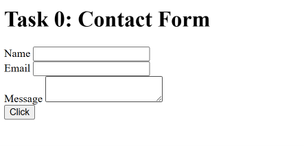

### Task 1. Form with HTML5 Validation
Add built-in validation attributes (`required`, `minlength`, `maxlength`, `type="email"`) and test how the browser enforces them.

Empty form:

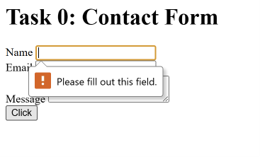

Invalid email:

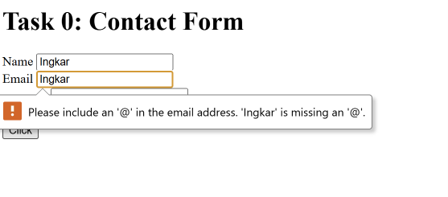

Short name:

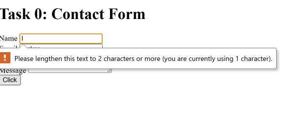

---

## Part 2. Bootstrap Forms

### Task 2. Bootstrap Form Styling
Recreate the contact form using Bootstrap classes, grid system, placeholders and helper text.

Wide screen:

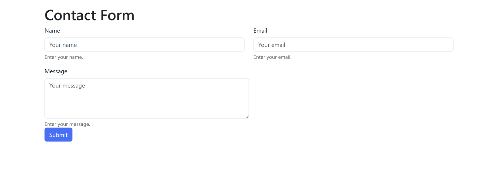

Narrow screen:

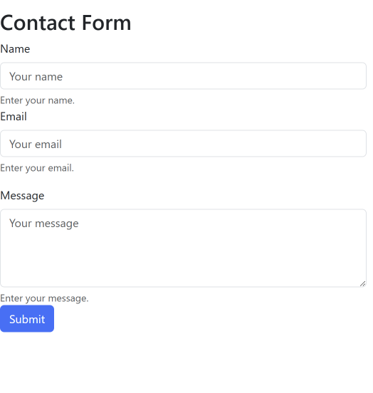

### Task 3. Bootstrap Validation Styles
Apply `is-valid` / `is-invalid` classes and show feedback messages below inputs.

Invalid data:

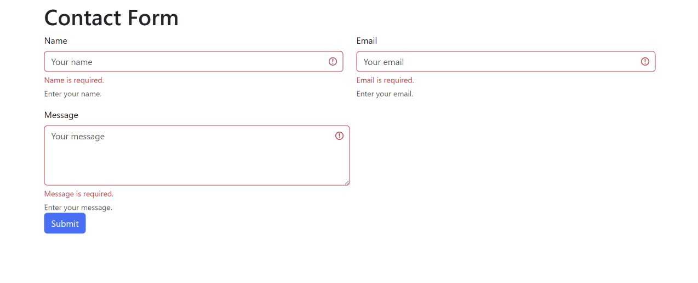

Valid data:

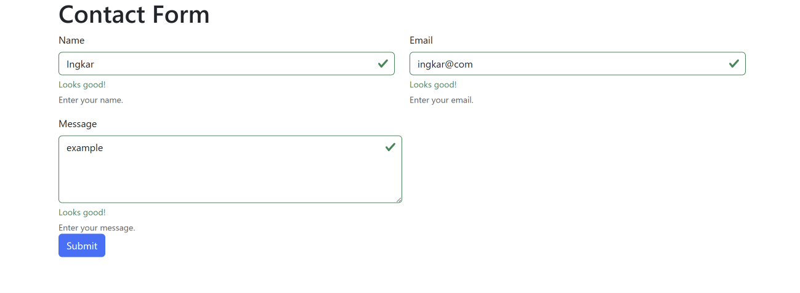

---

## Part 3. Advanced Form Project

### Task 4. Registration Form
Create a registration form: First/Last Name, Email, Password + Confirm Password, Gender (radio), Hobbies (checkboxes), Country (select), Submit and Reset. Responsive with Bootstrap Grid, HTML5 validation and Bootstrap feedback.

Empty form submitted:

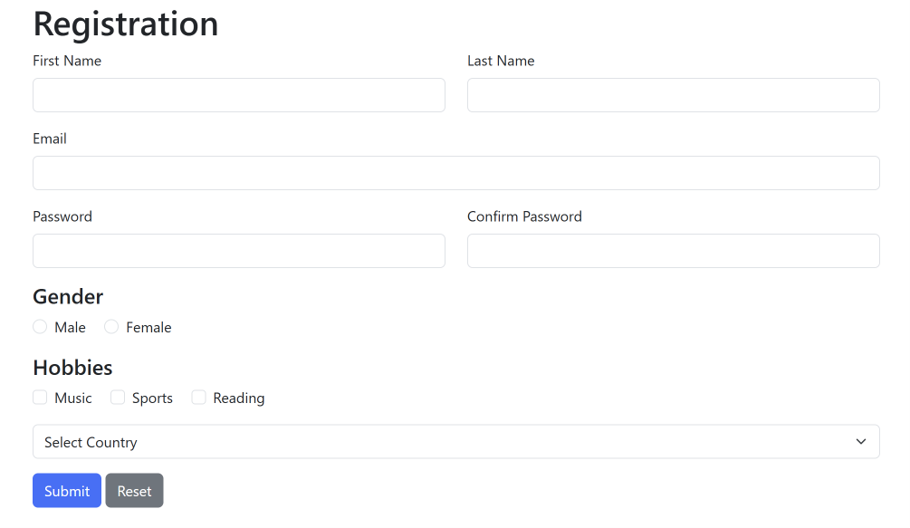

Passwords do not match:

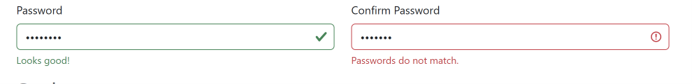

All data valid:

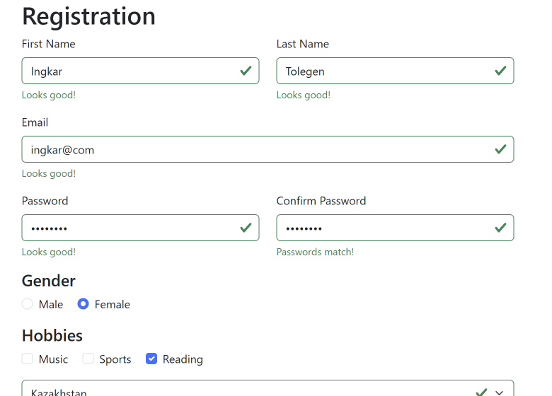

Mobile view:

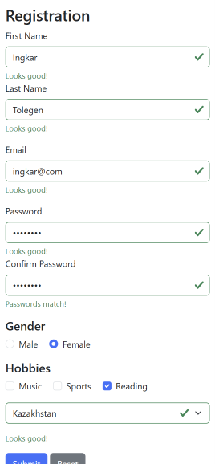

After Reset:

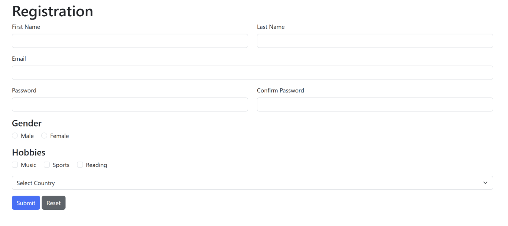

---

## Summary
[3-5 предложений своими словами: что делала, какие были трудности, что узнала про валидацию и Bootstrap]